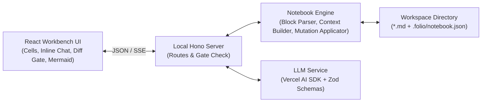
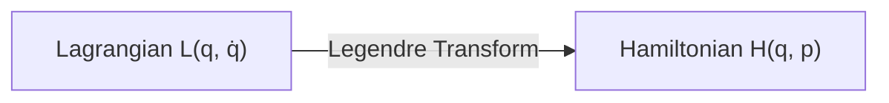

# Architecture — folio

## Goals

- Persist every notebook as a hierarchical folder of standalone, human-readable Markdown (`.md`) files that work outside the tool while preserving exact concept-block boundaries inside the workbench.
- Scope every LLM cell interaction deterministically to the ancestor Table of Contents tree plus a sliding window of cells ($N-1, N, N+1$), resolving via an atomic **Integrate**, **Branch**, or **Discard** action.
- Enforce a synchronous edit resolution gate so suggested coherence edits on adjacent cells ($N-1, N+1$) must be explicitly accepted or rejected before starting another cell chat.

## Constraints

- Local-only personal tool running on macOS (`localhost` client + local Node filesystem/LLM server); no cloud database, accounts, or hosted multi-user backend.
- Unconstrained Bring Your Own Model (BYOM) across frontier reasoning models (Anthropic, Google Gemini, OpenAI) using local API keys.
- Integration friction is the primary failure mode: diffs must be minimal, adjacent cells must never be mutated silently, and manual inline Markdown editing must always be available as an escape hatch.

## Approaches considered

1. **Local TypeScript Web App (`Vite` + `React` + `Hono` on Node) with Markdown + HTML comment block markers and `.folio/` sidecar**
   - A single TypeScript repo where a lightweight local Hono server reads/writes `.md` files and `.folio/state.json` on disk and calls frontier LLMs via the Vercel AI SDK + Zod, while a React frontend renders concept blocks, Mermaid diagrams, ephemeral inline chats, and diff accept/reject gates.
   - *Trade-off:* Requires starting a local server process, but keeps frontend, backend, and Zod LLM schemas in one language with rich interactive UI primitives and clean git-friendly Markdown files.
2. **Python Server-Driven UI (`FastAPI` + `Jinja2` + `HTMX`)**
   - Python backend manages files and Pydantic LLM schemas, returning HTML fragments over HTMX.
   - *Trade-off:* Strong backend ergonomics, but streaming multi-turn inline chats, rendering client-side Mermaid diagrams, and managing interactive diff gates across adjacent cells become brittle in HTMX.
3. **Native Desktop Wrapper (`Tauri` or `Electron`)**
   - Wraps the web workbench in a standalone desktop shell with native filesystem IPC.
   - *Trade-off:* Native Dock icon, but adds Rust/IPC or Electron packaging overhead before proving the core cell-integration workflow.

## Recommended approach

**Approach 1 (Local TypeScript Web App + Markdown with HTML comment block delimiters + `.folio/` sidecar).** It shares TypeScript and Zod schemas across the LLM integration contract and the UI, gives full control over interactive diff review and Mermaid rendering, and guarantees that the files on disk remain clean, standalone Markdown documents.

## Stack

- Language: TypeScript 7 (Node.js 24 LTS)
- Framework: React 19 + Vite 8 (frontend), Hono 4 on `@hono/node-server` (local backend API)
- LLM: Vercel AI SDK 7 (`ai` + `@ai-sdk/anthropic`, `@ai-sdk/google`, `@ai-sdk/openai`) + Zod 4
- Storage: Local filesystem Markdown (`.md`) with `<!-- folio:block id="<id>" -->` delimiters + `.folio/notebook.json` sidecar
- Tests: Vitest 5 + React Testing Library, run with `npm test`
- Deploy: Local process on `http://localhost:3000` started via `npm run dev`

## Shape of the system



- **`src/shared/schema.ts` (Contracts & Types):** Zod schemas shared between server and client — `ConceptBlock`, `DocumentNode`, `PendingSuggestedEdit`, `EphemeralChatThread`, and the LLM `IntegrateResultSchema`.
- **`src/server/markdown.ts` (Block Parser & Serializer):** Pure functions that parse a `.md` file into an ordered array of `ConceptBlock` items using `<!-- folio:block id="..." -->` markers (and auto-assigning IDs if a user edited the `.md` externally), and serialize blocks back into clean Markdown. Also extracts headings per document to build the Table of Contents dynamically.
- **`src/server/context.ts` (Bounded Context Builder):** Given a target `docId` and `blockId` (cell $N$), walks the parent chain in `.folio/notebook.json` to assemble:
  1. Ancestor Tables of Contents up to the root document.
  2. Current document Table of Contents.
  3. Sliding window of cells: $N-1$, $N$, and $N+1$.
- **`src/server/llm.ts` (LLM Adapter):** Wraps Vercel AI SDK `streamText` (for multi-turn inline cell Q&A) and `generateObject` (for seeding a document, branching a child document, and running the `Integrate` pass with `IntegrateResultSchema`).
- **`src/server/store.ts` (Workspace Store & Gatekeeper):** Reads and writes `.md` files and `.folio/notebook.json`. Enforces the **synchronous edit resolution gate**: rejects any request to start a new cell chat or run an LLM mutation while `pendingSuggestedEdits` is non-empty for the active document.
- **`src/client/` (React Workbench):** Document tree sidebar, model/prompt selector, concept block list (Markdown + Mermaid renderer, inline raw Markdown editor, split/merge/delete controls), ephemeral cell chat drawer with **Integrate / Branch / Discard** actions, and inline diff accept/reject banners on cells with pending suggested edits.

## Data

### On-disk layout (per notebook workspace folder)

```
<workspace>/
  index.md                    # Root document
  <child-slug>.md             # Branched child documents
  .folio/
    notebook.json             # Tree hierarchy, active ephemeral chats, and pending suggested edits
```

### Markdown block format (`*.md`)

```markdown
<!-- folio:block id="blk_01" -->
## 1. Hamiltonian Formulation

The Hamiltonian $H(q, p)$ represents total energy in generalized coordinates...



<!-- folio:block id="blk_02" -->
### Canonical Equations
...
```

When a cell branches into a child document, the parent block ends with a standard Markdown link (`[→ Deep dive: Canonical Transformations](canonical-transformations.md)`) so navigation works in any external Markdown viewer.

### Sidecar state (`.folio/notebook.json`)

- **`documents`**: Map of `docId` $\rightarrow$ `{ id, title, filename, parentId, parentBlockId, childDocIds[] }`.
- **`pendingEdits`**: Array of `{ id, docId, blockId, originalMarkdown, proposedMarkdown, reason, sourceBlockId }`. Non-empty `pendingEdits` on a document locks new cell chats until resolved.
- **`activeChat`** (optional): `{ docId, blockId, modelId, messages[] }` so an in-progress ephemeral chat survives a browser refresh until resolved via Integrate, Branch, or Discard.

### LLM Integration Schema (`IntegrateResultSchema`)

- **`updatedBlockMarkdown`**: `string | null` — direct replacement for cell $N$.
- **`insertedBlocksMarkdown`**: `string[]` — 0 or more new concept blocks inserted immediately after cell $N$.
- **`suggestedEdits`**: `Array<{ targetBlockId: string, proposedMarkdown: string, reason: string }>` — restricted to adjacent window blocks ($N-1$, $N+1$) and staged into `pendingEdits` for user approval.

## Key decisions

- **Markdown with HTML comment block delimiters + `.folio/` sidecar** over standalone HTML or SQLite/JSON notebooks ([ADR 0001](../adr/0001-markdown-block-delimiters-and-sidecar.md)): preserves 100% standalone readability and git diffability while keeping transient state (pending diffs, active chat) out of the prose.
- **Immediate block generation (4–8 blocks)** over mandatory two-step outline approval: gets the user into the reading and inline-chat loop immediately on both initial topic seed and sub-document branch.
- **Direct manual cell manipulation included**: users can edit raw Markdown inline and split, merge, or delete concept blocks directly without invoking the LLM.
- **Transcript-seeded branching with standard Markdown links**: branching a chat on cell $N$ generates a child `.md` file seeded from the chat transcript + bounded context, records the parent-child edge in `.folio/notebook.json`, and appends a standard relative Markdown link to cell $N$.
- **Vercel AI SDK + Zod `generateObject`** for multi-cell integration: unifies Anthropic, Google Gemini, and OpenAI reasoning models behind a single typed contract.

## Risks and spikes

- **Risk — Over-eager adjacent diffs during Integrate:** The LLM may propose cosmetic rewrites to $N-1$ or $N+1$ when no narrative transition actually broke, creating review fatigue.
  - *Mitigation:* System prompt for `Integrate` explicitly instructs the model to leave `suggestedEdits` empty unless a factual contradiction, duplicate explanation, or broken transition was introduced in $N-1$ or $N+1$, and server validation drops any `suggestedEdit` whose `targetBlockId` is outside $[N-1, N+1]$ or identical to current text.
- **Risk — External edits stripping block comments:** If the user edits `.md` in an external editor and deletes a `<!-- folio:block -->` comment, blocks could merge unexpectedly.
  - *Mitigation:* The parser treats missing delimiters gracefully (splitting on top-level `## ` headings when a file has no block markers, and persisting newly assigned block IDs on next save).

No pre-phase spike is required; Phase 01 will validate the `Integrate` prompt and schema directly against live frontier models.

## Open questions

None. All concept open questions have been resolved and folded into the architecture.
